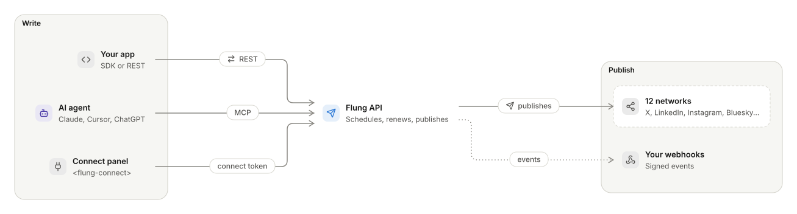

<p align="center">
  <a href="https://docs.flung.dev">
    <picture>
      <source media="(prefers-color-scheme: dark)" srcset="https://assets.flung.dev/brand/logo/flung-lockup-on-dark.svg">
      
    </picture>
  </a>
</p>

<h3 align="center">Social media posting, built for apps and AI agents.</h3>

<p align="center">
  One API to connect accounts and publish to twelve networks.<br>
  Your code or your agent writes the post; Flung gets it out on time.
</p>

<p align="center">
  <a href="https://docs.flung.dev"><b>Docs</b></a> &nbsp;·&nbsp;
  <a href="https://docs.flung.dev/reference/api"><b>API reference</b></a> &nbsp;·&nbsp;
  <a href="https://docs.flung.dev/agents/overview"><b>For AI agents</b></a> &nbsp;·&nbsp;
  <a href="https://github.com/flung-official/flung-sdk"><b>SDK</b></a> &nbsp;·&nbsp;
  <a href="https://github.com/flung-official/flung-sdk/tree/main/packages/connect"><b>Connect panel</b></a> &nbsp;·&nbsp;
  <a href="https://api.flung.dev/status"><b>Status</b></a>
</p>

<br>

## Contents

- [The problem](#the-problem)
- [What Flung does](#what-flung-does)
- [Start in a minute](#start-in-a-minute)
- [Repositories](#repositories)

## The problem

| Problem | Today |
|---|---|
| **Twelve APIs, twelve sets of rules** | Every network has its own sign-in, media limits, rate limits and ways to fail. |
| **Connections quietly expire** | Tokens run out, refreshes fail, and posts stop going out with nobody told. |
| **Agents cannot post** | AI agents write the words but have no safe way to sign in to a network and publish. |

## What Flung does

One API between your product and the networks, with the hard parts kept on our side.

<p align="center">
  <picture>
    <source media="(prefers-color-scheme: dark)" srcset="assets/how-it-works-dark.svg">
    
  </picture>
</p>

<p align="center"><sub>Drawn by <a href="https://plotwork.dev">Plotwork</a> from <a href="assets/how-it-works.diagram">16 lines of text</a>.</sub></p>

| Feature | What you get |
|---|---|
| **Twelve networks** | X, Instagram, Facebook, Threads, LinkedIn, TikTok, YouTube, Pinterest, Bluesky, Mastodon, Discord and Farcaster. |
| **Connect from your page** | `<flung-connect>` lets your users connect and disconnect accounts, with a short-lived token your server makes. |
| **Connections that last** | Tokens are renewed before they expire, and you hear about the ones that need a person a week ahead. |
| **Images and video** | Uploads up to 1 GB, checked against each network's limits before a post is accepted. |
| **Scheduled and retried** | Each post publishes when it is due, retries what can be retried, and reports each network's result. |
| **Signed webhooks** | Standard Webhooks events for every post and account change. |
| **Built for agents** | An MCP server with OAuth, so an agent connects accounts and posts only after a person approves it. |

## Start in a minute

<p>
  <a href="https://www.npmjs.com/package/@flung.dev/connect"></a>
  <a href="https://www.npmjs.com/package/@flung.dev/sdk"></a>
  
</p>

**With an AI agent** (Claude Code shown; any MCP client that speaks OAuth works):

```sh
claude mcp add --transport http flung https://mcp.flung.dev/mcp-oauth
```

**From your server**:

```ts
import { Flung } from '@flung.dev/sdk'

const flung = new Flung({ apiKey: process.env.FLUNG_API_KEY! })
await flung.posts.create({ content: 'Launching today.', accountIds, publishAt: '2026-11-01T09:00:00Z' })
```

**On your page**, with a connect token from your server:

```html
<script type="module">import '@flung.dev/connect/register'</script>
<flung-connect token="flung_ct_..."></flung-connect>
```

## Repositories

| Repository | What it is |
|---|---|
| [flung-sdk](https://github.com/flung-official/flung-sdk) | `@flung.dev/connect`, the connect panel for your page, and `@flung.dev/sdk`, the typed API client, with Next.js and React examples. |
| [flung-mcp](https://github.com/flung-official/flung-mcp) | Connect any AI agent to the hosted MCP server: install steps for each client, and the 28 tools. |
